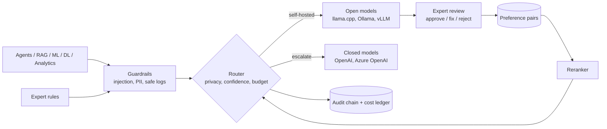
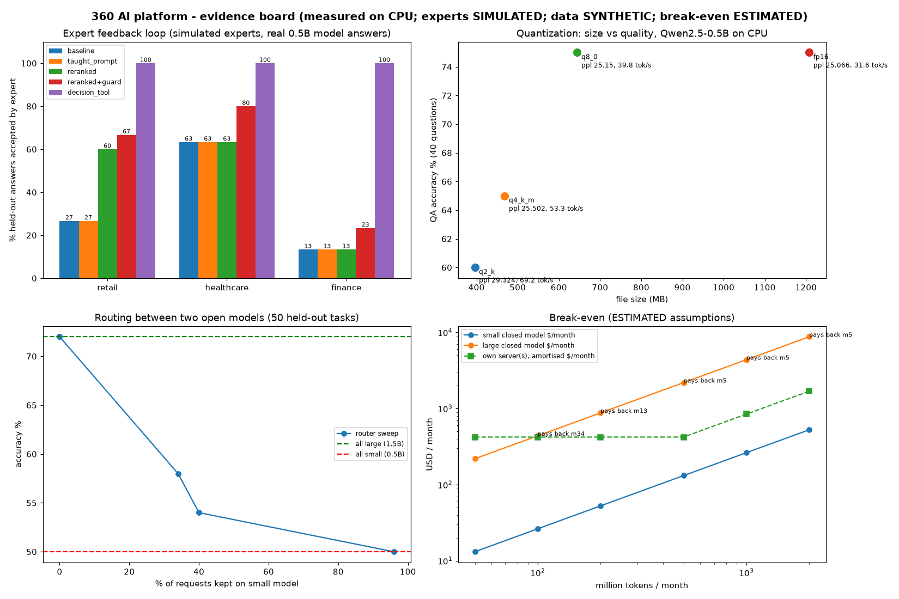

# Jagadish-360-ai-platform

**One governed platform for agents, GenAI/RAG, classic ML, deep learning and analytics, running on closed or open
models, in any cloud or on a single on-prem server, with domain experts teaching it.**

**Recruiter summary.** Businesses in many domains want AI but face three questions: which model (closed API or
self-hosted open model), where it runs (which cloud, or their own box), and how it learns their domain's fine print.
This repo answers all three in working code: a model gateway that routes by privacy, confidence and budget; real
open models measured on CPU at four quantization levels; one Helm chart with five deployment profiles plus validated
Terraform for three clouds; a break-even calculator for buying a server versus paying per token; and an expert
feedback loop where domain experts' rules and reviews become guardrails, tests and preference pairs. In the loop,
the output guard took rule violations to **0 in all three domains**, and reranking sampled answers lifted retail from
**27% to 60%** accepted, using a real 0.5B open model on CPU, simulated experts and synthetic tasks.

> Honesty labels: experts are **SIMULATED**, all business data is **SYNTHETIC**, GPU and server figures are
> **ESTIMATED**, and CPU numbers are **MEASURED** on the build machine (8 vCPU, no GPU). The closed provider
> (OpenAI gpt-4o-mini, Azure OpenAI) is wired and unit-tested but was **not run**: the available key had no quota.
> Companies named in the data (Tallowmere Home, Fenwrick Health, Quillbrook Mutual) are fictional.

## Purpose and who it is for
- **Delivery teams** building AI for several industries who want one platform instead of a stack per project.
- **Small businesses** deciding whether a one-time inference server beats a monthly token bill.
- **Regulated customers** who need data to stay on infrastructure they control.
- **Domain experts** who know the edge cases and want a structured way to teach them to the system.

## Architecture



Full diagrams (runtime and deployment) and a file map: [docs/architecture.md](docs/architecture.md).

## How it works
1. Every workload calls the gateway (in-process or via the OpenAI-compatible HTTP API from `p360 serve`).
2. The input guard blocks injection attempts and redacts PII; the closed model only ever sees redacted text.
3. The router keeps PII and restricted tenants on self-hosted models, sends confident cases to the cheap open
   model, and escalates the rest to a closed model while the tenant's budget lasts.
4. Retries, circuit breakers, call caps and fallback handle failures; the output is redacted again; cost and a
   hash-chained audit entry are recorded.
5. Experts write rule packs, review answers with reasons, and their corrections train a reranker.

Step-by-step detail: [docs/how-it-works.md](docs/how-it-works.md).

## Real code and real output

The gateway's routing core (`src/p360/router.py`):
```python
def decide(prompt, *, pii, restricted, model=DEFAULT, threshold=0.6, closed_budget_ok=True):
    c = model.score(prompt)
    if pii or restricted:
        return Decision("open", "privacy: data stays on self-hosted model", c)
    if c >= threshold:
        return Decision("open", f"confidence {c:.2f} >= {threshold}", c)
    if not closed_budget_ok:
        return Decision("open", "closed-model budget spent; degraded to open", c)
    return Decision("closed", f"confidence {c:.2f} < {threshold}; escalate", c)
```

The expert's rules as an output guard (`src/p360/expert/rules.py`):
```python
def guard(pack, answer, prompt=""):
    v = violations(pack, answer, prompt)
    by_id = {r.id: r for r in pack["rule_objs"]}
    if any(by_id[i].kind == "must_not" for i in v):
        return HANDOFF
    extra = [by_id[i].append for i in v if by_id[i].append]
    return " ".join([answer.strip(), *extra]) if extra else answer
```

`p360 demo` output (offline, stub models):
```text
{
 "agent": "refunded",
 "agent_high_value": "waiting for human approval",
 "rag": [
  "P1",
  "P2"
 ],
 "rag_abstain": true,
 "ml": {
  "auc": 0.7945,
  "accuracy": 0.7533,
  "majority_baseline": 0.63,
  "n_test": 300,
  "data": "synthetic"
 },
 "dl": {
  "mlp_accuracy": 0.946,
  "linear_accuracy": 0.64,
  "n_test": 500,
  "data": "synthetic"
 },
 "analytics_rows": 3000,
 "pii_blocked_example": "open",
 "injection_blocked": "prompt_injection",
 "audit_entries": 20,
 "audit_chain_ok": true
}
```

## Results

<!-- RESULTS:START -->

**Tests:** 105 (counted by `scripts/count_tests.py`).

### Expert feedback loop (SIMULATED experts, SYNTHETIC tasks, real local model answers)

Generator: `qwen2.5-0.5b-instruct-q4_k_m.gguf` via llama.cpp on CPU, 4 samples per task. Share of held-out answers the simulated expert accepts (right decision and every rule kept):

| domain | test tasks | pairs | baseline | taught prompt | reranked | reranked + guard | decision tool + guard |
|---|---|---|---|---|---|---|---|
| retail | 30 | 133 | 27% | 27% | 60% | 67% | 100% |
| healthcare | 30 | 84 | 63% | 63% | 63% | 80% | 100% |
| finance | 30 | 144 | 13% | 13% | 13% | 23% | 100% |

Rule violations on held-out answers:

| domain | baseline | taught prompt | reranked | reranked + guard | decision tool + guard |
|---|---|---|---|---|---|
| retail | 8 | 8 | 3 | 0 | 0 |
| healthcare | 5 | 5 | 5 | 0 | 0 |
| finance | 11 | 11 | 11 | 0 | 0 |

### Quantization on CPU (MEASURED, 40-question self-written regression set)

| file | size MB | QA accuracy | agrees with fp16 | perplexity | decode tok/s |
|---|---|---|---|---|---|
| qwen2.5-0.5b-instruct-q2_k.gguf | 395.9 | 60% | 32% | 29.324 | 69.2 |
| qwen2.5-0.5b-instruct-q4_k_m.gguf | 468.6 | 65% | 60% | 25.502 | 53.3 |
| qwen2.5-0.5b-instruct-q8_0.gguf | 644.4 | 75% | 90% | 25.15 | 39.8 |
| qwen2.5-0.5b-instruct-fp16.gguf | 1207.8 | 75% | 100% | 25.066 | 31.6 |

### Routing between two open models on CPU (MEASURED, 50 held-out tasks; closed provider wired, not run)

All small (`qwen2.5-0.5b-instruct-q4_k_m.gguf`): 50% in 7.47 s. All large (`qwen2.5-1.5b-instruct-q4_k_m.gguf`): 72% in 46.57 s. Best possible per-task pick: 72%.

| threshold | share to small | accuracy | CPU seconds |
|---|---|---|---|
| 0.3 | 96% | 50% | 8.79 |
| 0.4 | 40% | 54% | 42.88 |
| 0.5 | 40% | 54% | 42.88 |
| 0.6 | 34% | 58% | 43.8 |
| 0.7 | 0% | 72% | 46.57 |
| 0.8 | 0% | 72% | 46.57 |

### Break-even (ESTIMATED from editable assumptions in `src/p360/breakeven.py`)

| tokens / month (M) | servers | local $/1M tok | small API $/month | payback vs small API | large API $/month | payback vs large API |
|---|---|---|---|---|---|---|
| 50 | 1 | 8.4344 | 13.12 | never (36 mo) | 218.75 | never (36 mo) |
| 100 | 1 | 4.2172 | 26.25 | never (36 mo) | 437.5 | month 34 |
| 200 | 1 | 2.1086 | 52.5 | never (36 mo) | 875.0 | month 13 |
| 500 | 1 | 0.8434 | 131.25 | never (36 mo) | 2187.5 | month 5 |
| 1000 | 2 | 0.8434 | 262.5 | never (36 mo) | 4375.0 | month 5 |
| 2000 | 4 | 0.8434 | 525.0 | never (36 mo) | 8750.0 | month 5 |

### Classic ML and DL (SYNTHETIC data, offline)

Churn logistic regression AUC 0.7945 (accuracy 0.7533 vs majority baseline 0.63, n=300). Anomaly MLP accuracy 0.946 vs linear 0.64 (n=500).

<!-- RESULTS:END -->

What the numbers say, plainly:
- **Prompt teaching alone did nothing for a 0.5B model.** Its greedy answers were YES almost every time, with or
  without the expert's rules and checker facts.
- **Sampling plus the expert-trained reranker helped where samples disagreed** (retail), and could not help where
  every sample had the same wrong decision (finance).
- **The expert rules as an output guard removed every rule violation** in all three domains.
- **The decision-tool arm scores 100% partly by construction**: the expert's checker encodes the same policy the
  simulated expert grades against. The point is the design (experts own the decision logic, the model explains),
  not the number.
- **Routing between the two open models did not beat "always use the larger one"** on this task mix: the 0.5B model
  was right on too few tasks for the router to find a safe slice. It does cut CPU time when you accept lower accuracy.
- **Break-even:** against a cheap closed model a single server never pays back at these volumes; against a larger
  closed model it pays back within months at a few hundred million tokens a month.



## How to run

Offline (no model, no key):
```bash
python -m venv .venv && . .venv/bin/activate
pip install -e ".[dev]"
pytest -q
p360 demo
p360 breakeven --tokens-m 300
p360 expert-loop
python scripts/render_docs.py --check
```

With a real open model on CPU:
```bash
pip install -e ".[local]"
python scripts/bench_quant.py --models <q2_k.gguf> <q4_k_m.gguf> <q8_0.gguf> <fp16.gguf>
python scripts/gen_candidates.py --model <qwen2.5-0.5b-instruct-q4_k_m.gguf>
python scripts/bench_router.py --small <0.5b q4_k_m> --large <1.5b q4_k_m>
p360 serve --config config/gateway.json
```

Optional closed model (billable): export `AZURE_OPENAI_API_KEY` and keep `max_calls` and budgets set.
Deployment (Helm, profiles, Terraform, Bicep): [docs/implementation-guide.md](docs/implementation-guide.md).

## Guardrails and security
Injection screen, PII redaction in and out (with Luhn-checked cards and keyed pseudonyms), redacting logs and safe
errors, privacy routing, budgets and call caps, circuit breakers, hash-chained audit, least-privilege agent tools with
human approval, RAG abstention, small-cell suppression, expert rules as tests and guard, hardened pods and a network
policy around the model server. Full table with the test for each: [docs/guardrails.md](docs/guardrails.md).
Threat model: [docs/threat-model.md](docs/threat-model.md). Decisions: [docs/adr](docs/adr).

## Limitations and known failures
- **Experts are simulated.** Real experts disagree, make mistakes and get tired; nothing here measures that.
- **Small task sets.** 30 held-out tasks per domain and a 40-question QA set are regression checks, not benchmarks.
- **The 0.5B model is weak at policy decisions** (13-63% accepted at baseline). Kept visible in the results.
- **The router found no gain** over always using the 1.5B model on this mix. Kept visible.
- **No weight tuning.** The reranker chooses among the model's own answers; DPO/LoRA needs a GPU (planned).
- **Closed models not run** (no quota). Their path is covered by unit tests with stubs only.
- **GPU numbers are estimates.** `scripts/bench_vllm.md` explains how to replace them.
- **Regex PII detection** misses names and free-text identifiers.
- **Injection screen is pattern based**; paraphrased attacks can pass it.
- **Tenant comes from the request**, not from the token (planned).

## Built vs planned

| part | status | evidence |
|---|---|---|
| Model gateway, router, HTTP API, retries, breaker, caps, budgets | Built | `test_gateway.py` |
| OpenAI and Azure OpenAI backends | Built, **not run live** (no API quota) | stub-based tests |
| llama.cpp open-model backend on CPU | Built and run | `results/quant.json`, `results/router.json` |
| Ollama and vLLM backends (same HTTP client) | Built, not run here | config + tests |
| Quantization benchmark (4 levels) | Built and run | `results/quant.json` |
| Router fitted on real outcomes of two open models | Built and run | `results/router.json` |
| Agents, RAG, ML, DL, analytics on shared controls | Built and run (offline) | `test_workloads.py`, `results/offline.json` |
| Break-even calculator with sourced assumptions | Built | `test_breakeven.py` |
| Expert rule packs -> tests + guard, review CLI, pairs, reranker | Built and run | `results/expert_loop.json` |
| Domain onboarding playbook and template | Written | `docs/domain-onboarding-playbook.md`, `p360 new-domain` |
| Dockerfile, Helm chart, 5 profiles | Written, linted and rendered in CI; not deployed | CI `iac` job |
| Terraform (Azure, AWS, GCP) and Bicep (Azure) | Written and validated; **never applied** | CI `iac` job |
| DPO/LoRA weight tuning of the open model | Planned (needs GPU) | |
| vLLM GPU throughput benchmark | Planned (needs GPU) | `scripts/bench_vllm.md` |
| Token-bound tenants, per-tenant rate limits, write-once audit storage | Planned | threat model |
| Real domain experts | Planned | playbook |

## Docs
[architecture](docs/architecture.md) · [how it works](docs/how-it-works.md) · [guardrails](docs/guardrails.md) ·
[threat model](docs/threat-model.md) · [ADRs](docs/adr) · [implementation guide](docs/implementation-guide.md) ·
[domain onboarding playbook](docs/domain-onboarding-playbook.md) · [interview points](docs/interview-points.md)

## Related repos
- [Jagadish-enterprise-agent-usecases](https://github.com/jagadishmazure-jpg/Jagadish-enterprise-agent-usecases): the
  small decision router idea this gateway's confidence router is based on, and 22 governed agents.
- [Jagadish-azure-aks-agent-platform](https://github.com/jagadishmazure-jpg/Jagadish-azure-aks-agent-platform): the
  Azure-specific agent platform on AKS; this repo is the multi-cloud and on-prem counterpart.
- [Jagadish-portfolio-catalog](https://jagadishmazure-jpg.github.io/Jagadish-portfolio-catalog/): reads `catalog/agents.json`.

## License
MIT. See [LICENSE](LICENSE) and [SECURITY.md](SECURITY.md).
