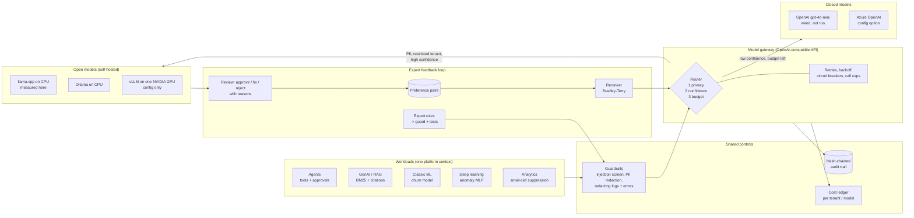
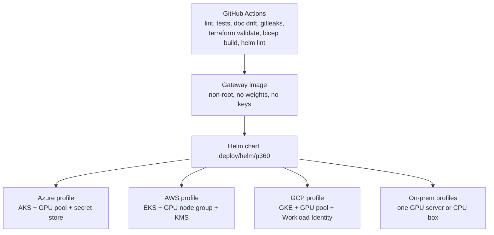

# Architecture

## Deployment view

The same chart deploys everywhere; a profile file only changes the inference engine, node placement and
where secrets come from. Terraform for each cloud and Bicep for Azure are validated in CI and never applied.

## Components and files

| component | file | notes |
|---|---|---|
| Guardrails | `src/p360/guardrails.py` | patterns + Luhn checksum, keyed HMAC pseudonyms, log filter, safe errors |
| Audit trail | `src/p360/audit.py` | SHA-256 chain; `verify()` detects edits |
| Cost ledger | `src/p360/cost.py` | list prices with an as-of date; local cost from the break-even model |
| Backends | `src/p360/backends.py` | OpenAI, Azure OpenAI, Ollama, vLLM (one HTTP client), llama.cpp in-process, offline stub |
| Router | `src/p360/router.py` | privacy rule, then a 6-feature logistic confidence model, then budget |
| Gateway + HTTP | `src/p360/gateway.py`, `server.py` | bearer token, 64 KB body cap, generic errors |
| Workloads | `src/p360/workloads/` | agent, rag, ml, dl, analytics |
| Break-even | `src/p360/breakeven.py` | every assumption has a source note |
| Expert loop | `src/p360/expert/` | rules, tasks, review, tune, loop |
| Deploy | `Dockerfile`, `deploy/` | Helm, 5 profiles, Terraform x3, Bicep |
